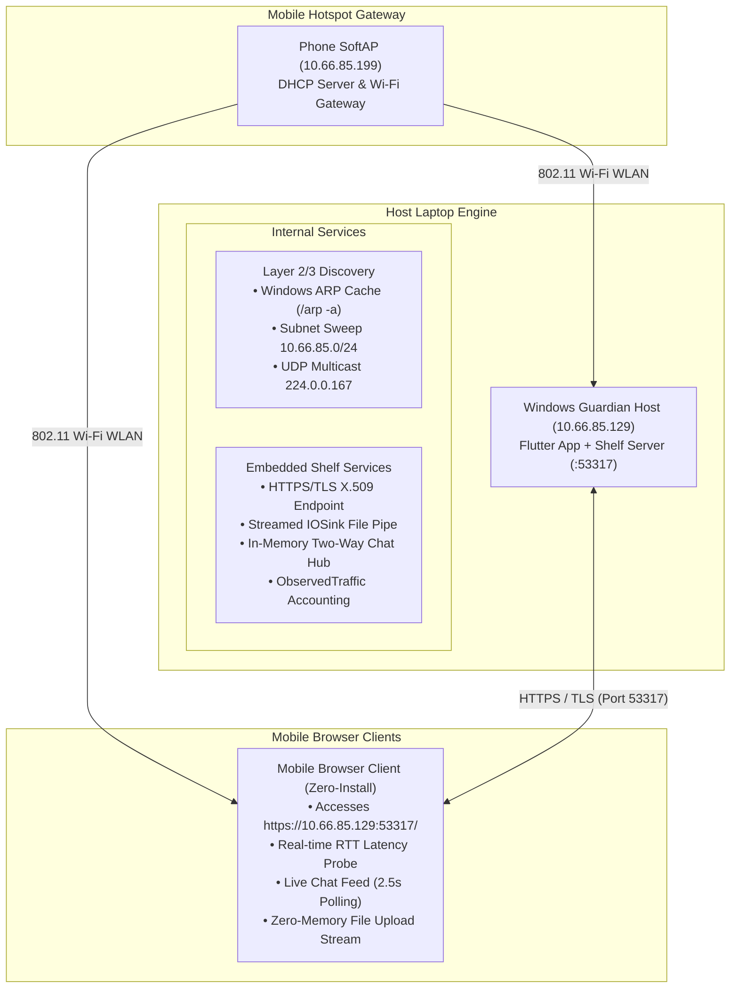
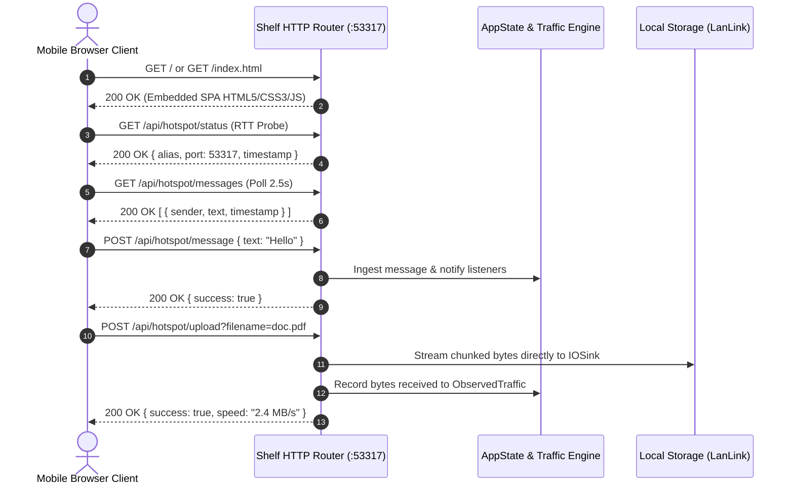
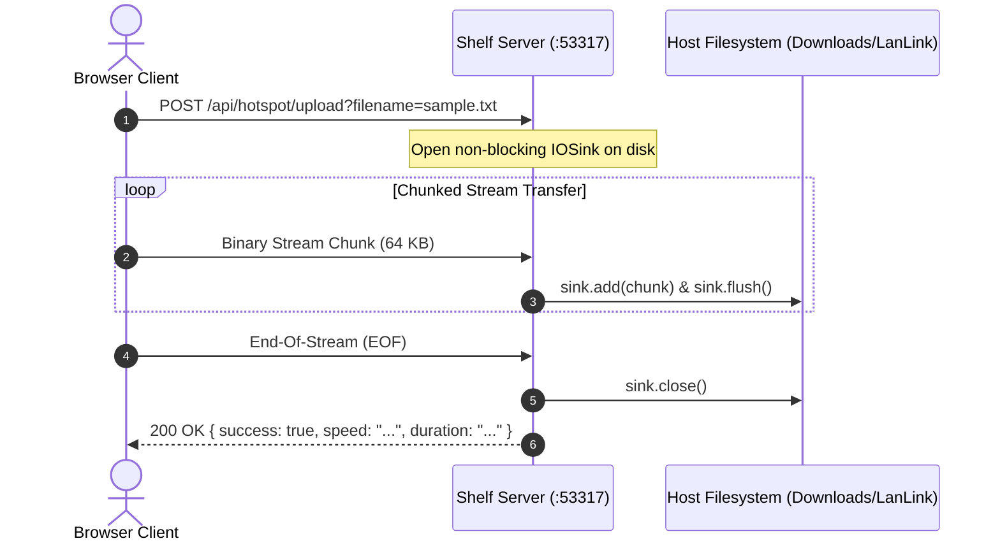
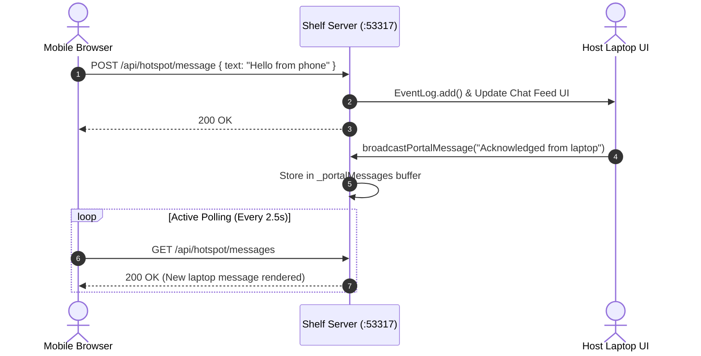
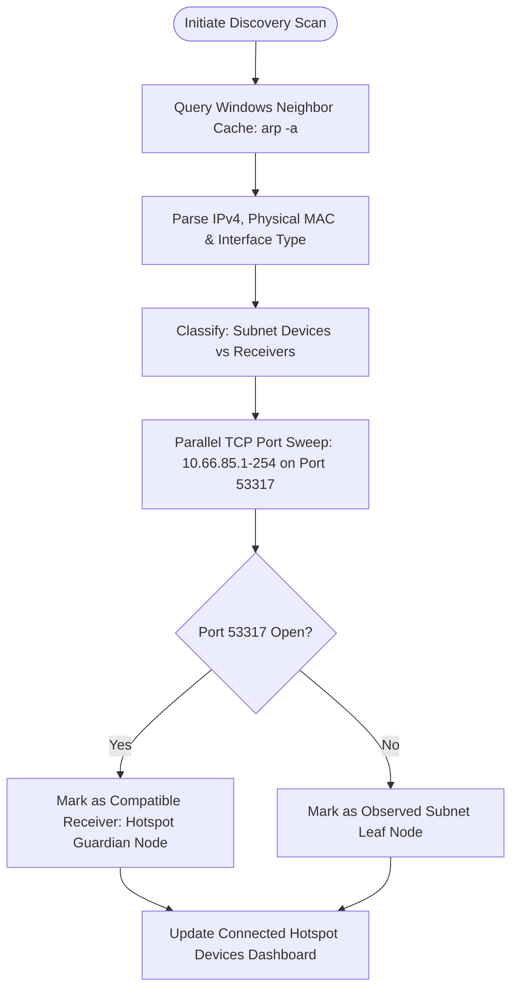
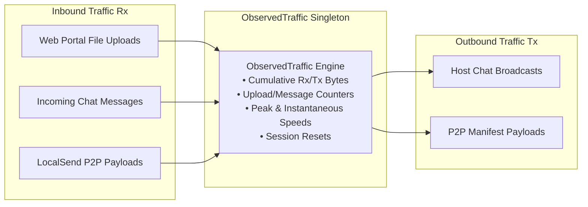
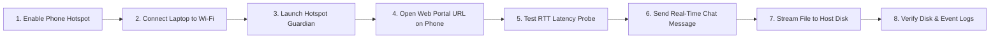

# Hotspot Guardian — Architecture Diagram Source Definitions

This document contains the text and Mermaid specification definitions for all 7 technical engineering diagrams used in the **Hotspot Guardian** technical report.

---

## Diagram 1: Overall Physical & Logical Hotspot Network Architecture

---

## Diagram 2: Web Portal Request Flow & Route Execution

---

## Diagram 3: Streaming File Upload Sequence (Zero-Memory Pipeline)

---

## Diagram 4: Two-Way Live Chatroom & Messaging Transport

---

## Diagram 5: Hybrid Device Discovery Workflow

---

## Diagram 6: Observed Application Data Accounting Architecture

---

## Diagram 7: End-to-End User Operational Workflow

